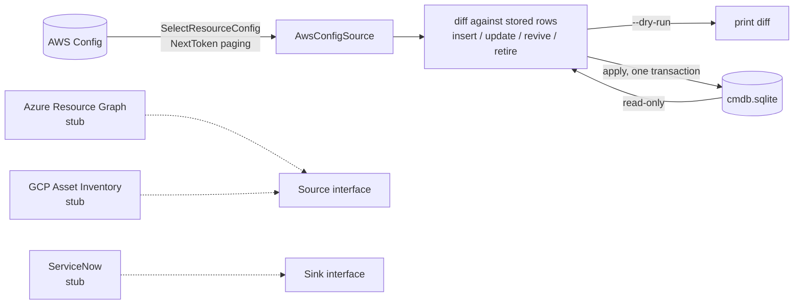

# AWS Config to SQLite CMDB sync

A small Python tool that pulls the current inventory from AWS Config and
keeps a SQLite CMDB in step with it. New resources are inserted, changed
ones updated, missing ones **soft-retired** (the row stays), and resources
that come back are revived. A dry run prints the diff without writing, and
a second run with the same data changes nothing.

> **Status:** AWS Config as the source and SQLite as the database are
> implemented and tested (20 pytest tests) with a fake Config client and
> temporary SQLite files. **Azure Resource Graph, GCP Asset Inventory and
> ServiceNow are interface stubs** that raise `NotImplementedError`. Nothing
> has called AWS.

## Problem

> Write a comprehensive inventory and CMDB synchronization tool that pulls
> data from AWS Config / Azure Resource Graph / GCP Asset Inventory and
> pushes it into ServiceNow or a custom database.

Why it matters: a CMDB filled in by hand is out of date within weeks, so
nobody trusts it during an incident. Syncing it from what AWS Config
actually records, and retiring rows instead of deleting them, keeps it
current and keeps the history.

## How it works



1. **Fetch.** One AWS Config advanced query
   (`SELECT resourceId, resourceType, resourceName, awsRegion, accountId, arn, tags
   WHERE resourceType IN (...)`), following `NextToken` until the last page.
   Resource types must match `AWS::X::Y` before they go into the query text.
2. **Key.** Each row is keyed by `account/region/type/resource-id`. Bare
   resource IDs are not unique across accounts, regions and types, so the
   upsert is by resource ID scoped that way.
3. **Diff.** A content hash over name, ARN and sorted tags decides whether
   a row changed. Tag order doesn't matter.
4. **Apply.** One SQLite transaction: inserts, updates, revives, and soft
   retires (`status='retired'`, `retired_at` set). Rows are never deleted.

### Idempotency

Unchanged rows are not touched at all, not even a "last seen" timestamp,
so a second run with the same source data leaves the database
byte-for-byte the same (a test compares every row). The trade-off is that
the CMDB records when something changed, not when it was last checked.
There is deliberately no sync-run log table.

## Usage

```bash
python -m pip install -r requirements-dev.txt
python -m ruff check .
python -m ruff format --check .
python -m pytest -q

# Real run (needs config:SelectResourceConfig and an enabled Config recorder)
python -m cmdbsync --db cmdb.sqlite --type AWS::EC2::Instance --type AWS::S3::Bucket --dry-run
python -m cmdbsync --db cmdb.sqlite --type AWS::EC2::Instance --type AWS::S3::Bucket
```

Example dry-run output:

```
+ 123456789012/eu-west-2/AWS::EC2::Instance/i-0000000000000004
+ 123456789012/eu-west-2/AWS::S3::Bucket/reports-example-com
~ 123456789012/eu-west-2/AWS::EC2::Instance/i-0000000000000001
- 123456789012/eu-west-2/AWS::EC2::Instance/i-0000000000000003 (retire)
4 resources from AWS Config; 2 new, 1 changed, 0 revived, 1 retired
dry-run: database not changed
```

| Exit code | Meaning |
|---|---|
| 0 | synced, nothing to do, or dry-run printed |
| 1 | any error: API failure, unusable Config result, duplicate key, bad type |
| 3 | refused: the source returned nothing while the CMDB has active rows |

### Safety

- **Dry run** opens the database read-only (`mode=ro`); if the file doesn't
  exist it is treated as empty and not created.
- **Empty-source guard:** an empty result while rows are active usually
  means a broken query or missing permissions, not an empty estate. The tool
  refuses to retire everything unless `--allow-empty-source` is given.
- **All or nothing:** a failure mid-apply rolls back the whole transaction
  (tested).

## Table

`resources(key PK, account_id, region, resource_type, resource_id, name,
arn, tags_json, content_hash, status, first_seen, updated_at, retired_at)`

## Limits

- AWS Config only. Azure, GCP and ServiceNow are stubs.
- One account and region per run. For many accounts, an AWS Config
  aggregator with `SelectAggregateResourceConfig` is the natural next step;
  it is not built.
- Only identity fields and tags are stored, not the full configuration
  item.
- Config only knows what its recorder records; unrecorded types never
  appear.
- SQLite suits one writer. A shared CMDB would need a server database.

## Security notes

- Read-only against AWS: the only call is `SelectResourceConfig`.
- No credentials in code; boto3 uses the standard chain.
- The database holds resource names and tags, which can be sensitive.
